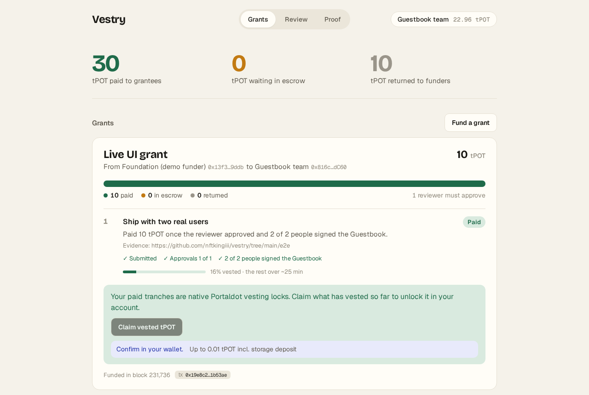

# Vestry

**Usage-vested payouts on Portaldot.** Vestry pays money out only when a reviewer quorum approves the work **and** the funded project's own contract shows the agreed usage, and it pays as a native Portaldot vesting lock, not a contract balance. Grants are the first use; incentive programs that reward real dApp activity are next ([docs/BUSINESS.md](docs/BUSINESS.md)).

Built for Portaldot Hacker House 2026 (Ecosystem DApps track).

Live app: https://vestry-grants.vercel.app (reads PortaldotV3 testnet directly)

## Why

Ecosystem programs fund builders in tranches. Today that means a spreadsheet, a reviewer's message and a manual transfer: the funder cannot see what was approved, the grantee cannot see what is owed, and nothing stops a tranche being paid before the product is used. Portaldot's own post-hackathon support is described as unlocked by progress, on-chain activity and milestone review. Vestry makes those three conditions enforceable on chain.

## How it works

1. **Fund.** A funder escrows a grant split into milestones. Each milestone has an amount, a deadline, an optional vesting period and an optional activity target.
2. **Submit.** The grantee posts delivery evidence (a commit, a URL, a tx hash).
3. **Review.** Reviewers approve until the quorum is reached. Any reviewer can request changes, which voids that round's approvals.
4. **Gate.** If the milestone has an activity target, Vestry reads it straight from the grantee's contract (for example `entryCount()` on their live app). Below target, approvals are kept and the funds stay in escrow; anyone can trigger `release()` once the number is met.
5. **Pay.** Native POT is sent through Portaldot's vesting precompile, so the grantee receives a pallet-vesting schedule that vests block by block; the grantee calls `vest()` to lift the lock on what has vested. Native `Assets` tokens are paid through their ERC-20 precompile.
6. **Reclaim.** After the deadline, an unreleased tranche returns to the funder.

## Architecture

```mermaid
flowchart LR
  F[Funder] -- createGrant + POT --> V[Vestry.sol<br/>pallet-revive]
  G[Grantee] -- submitMilestone --> V
  R[Reviewers] -- approve / requestChanges --> V
  V -- staticcall metric --> A[Grantee's contract<br/>e.g. Guestbook.entryCount]
  V -- vestedTransfer --> P[Vesting precompile<br/>0x…09020000]
  P --> VS[(pallet-vesting<br/>native lock on grantee)]
  V -- transfer --> E[ERC-20 precompile<br/>0x{assetId}…00010000]
  E --> AS[(pallet-assets)]
  V -- reclaim after deadline --> F
```

Solidity runs on Portaldot V3's `pallet-revive`. Vestry never holds a vesting schedule itself: the precompile writes a real `pallet-vesting` lock on the grantee's native account, which `scripts/readback.mjs` reads from the Substrate side.

## Portaldot integration

| Portaldot V3 feature | How Vestry uses it |
|---|---|
| `pallet-revive` (EVM-compatible execution) | Vestry, Guestbook and all grant logic, chain ID 420420777 |
| Vesting precompile (`pallet-vesting`) | Every native POT tranche becomes a native vesting schedule |
| Assets ERC-20 precompile (`pallet-assets`) | Grants can be denominated in a native asset |
| H160 ↔ AccountId32 mapping | Read-back resolves the grantee's native account with `reviveApi.accountId` |

### Findings for the Portaldot team

- On PortaldotV3 testnet the vesting precompile answers at `0x0000000000000000000000000000000009020000`. The constant in upstream `IVesting.sol` (`0x…0902`) returns empty data here.
- `minVestedTransfer` is `1e15` planck (10 tPOT), so smaller vested tranches revert.
- pallet-revive maps 1 planck to 10^4 wei, so native-POT milestone amounts must be multiples of 10^4 wei.

## Testnet deployment

PortaldotV3 testnet, chain ID 420420777, deployed 2026-10-21. There is no public block explorer yet; read these back over the EVM RPC (`eth_getTransactionReceipt`, `eth_getCode`).

| Contract | Address | Deploy tx | Block |
|---|---|---|---|
| Vestry | `0x12d0691c7B756AA5205f24B678D68C74B885cda9` | `0xc7c38b8fcfdf204fe825ea2437e9767b3d462c291f605e8b4103f18955cd118d` | 128768 |
| Guestbook (sample grantee app) | `0xc3Ee4B657FADAE473b22c692544e35223bFE9B42` | `0xc501d932533ecb7c5b25c854e287f0b495d80ece0d0a6fa3c85741c555931367` | 128769 |

On-chain code matches the compiled artifacts byte for byte. Details, gas and deposit costs are in [evidence/deployments.json](evidence/deployments.json).

Deploying held 423.4 tPOT for Vestry (5,253 bytes) and 49.8 tPOT for Guestbook (470 bytes) as storage deposits.

## Grant lifecycle on testnet

Run on 2026-10-21 by `scripts/flow.js` with throwaway testnet wallets (funder, grantee, two reviewers, two Guestbook users). The transactions were sent by the script, not clicked in the web app. Every step is in [evidence/testnet.json](evidence/testnet.json).

**Grant 1: two milestones of 10 tPOT, 2-of-2 review, milestone 2 needs two Guestbook users**

| Step | Tx | Block |
|---|---|---|
| Funder escrows 20 tPOT | `0xe93ef158861d40ae09642881e3c5a399eba716bfe6311a6b946bd6f6fe66b543` | 128995 |
| Milestone 1: grantee submits evidence | `0xaf809d2a559e88dfa8cd6b84a3dfe5640ce92a836cf885acaf964167219d7209` | 128997 |
| Milestone 1: reviewer 1 approves | `0x7332f6b90bbb7e8d89ced3e08bf08c6c2b6efed95e7b9f374019b555e5808e1d` | 128998 |
| Milestone 1: reviewer 2 approves, quorum reached, paid as a vesting lock | `0x427ad24c261d393a211484abc356d22e78d634c0e49b20e44836006279827b5b` | 128999 |
| Milestone 2: grantee submits evidence | `0xdf8c2af9f49a60b5bbe3088353db188ca196b6f9ae6371b2aa7e1e6d10a7ff3e` | 129000 |
| Milestone 2: reviewer 2 requests changes (approvals reset) | `0x1e811f48646c8f74a3de14bf11bc35723b901aa629f09afdffdbbf1a3bb275de` | 129001 |
| Milestone 2: grantee resubmits | `0x3e2d4e717a8d3c2506a7e7fb9a62f0d79debac257c9dffc1a25c81692a1d1b66` | 129002 |
| Milestone 2: reviewer 1 approves | `0x83df6be57c0c07aca702b5b8871025bd18909855429ff9bc78decc7efbbf039c` | 129003 |
| Milestone 2: reviewer 2 approves; quorum reached but Guestbook shows 0 of 2 users, so funds stay in escrow (`AwaitingMetric`) | `0x8acf565ebd28f10103ccbfacabcddd3894fe1f221899fc68928adb79aadebdd0` | 129004 |
| Guestbook user 1 signs | `0xe32697a00d31b5d358ce2c8e0674f2805d3dcaa802094821ce853f679bb6e257` | 129005 |
| Guestbook user 2 signs | `0x157799f00b05d7ae281bbace9777ecd2ff2f183959781378006b5647aa7d3da4` | 129006 |
| Milestone 2 released now that `entryCount()` = 2, paid as a vesting lock | `0x9a74a802b885b7d767499381a129dc4faa3b17b4097a705271da77e0d7c7b846` | 129007 |

**Grant 2: one milestone of 10 tPOT with a 3-minute deadline that the grantee misses**

| Step | Tx | Block |
|---|---|---|
| Funder escrows 10 tPOT | `0xf8ab33e24c31ca0e4d77c1fbf03134eead6c4af231105983a2a860e9e1739cfe` | 129008 |
| Funder reclaims the unpaid tranche after the deadline | `0x56a9a72915e2fb984676a0600e78760f4fb27d4084a19ccbdb125a3433d33310` | 129041 |

**Calls the contract refuses.** Each reverted with the expected error in a dry run (`eth_call`). The node does not include failing transactions in blocks, so these have no tx hash; they are recorded in `evidence/testnet.json` as dry-run proofs.

| Attempt | Revert |
|---|---|
| An outsider approves milestone 1 | `NotReviewer()` |
| Reviewer 1 approves milestone 1 twice | `AlreadyApproved()` |
| Anyone releases milestone 2 while the Guestbook has 0 users | `MetricBelowTarget(0, 2)` |
| The funder reclaims grant 2 before its deadline | `DeadlineNotPassed()` |
| The grantee submits grant 2 after its deadline | `DeadlinePassed()` |

### The payout is a native Portaldot lock

Both paid milestones landed as `pallet-vesting` schedules on the grantee's native account `5EzQM2V4AhH3142ebEhsEnvvAEcp17tK67YYu9gCJTYHZbbe` (H160 `0x816cc56DE60bE882c1bfD882ABd1a5500682dC60`), read from the Substrate side with `scripts/readback.mjs`. Once fully vested, the grantee called `vest()` on the vesting precompile with `scripts/vest.js` ([evidence/vest-claim.json](evidence/vest-claim.json)):

| | Native read-back |
|---|---|
| Before | 19.92 tPOT frozen in 2 vesting schedules of 10 tPOT |
| `vest()` tx | `0x4147764f9e1d87ba944c9c2ef7abb67359106d58401118a4d1aeb416d006f946` (block 135631, status 1) |
| After | 0 tPOT frozen, no vesting schedules |

### A grant driven through the live app

On 2026-10-28 `e2e/ui-run.mjs` opened https://vestry-grants.vercel.app in Chromium as funder, grantee and reviewer. MetaMask cannot run headless, so each browser had an injected EIP-1193 test wallet holding a testnet burner key; every transaction below was triggered by clicking the app's own buttons ([evidence/ui-run.json](evidence/ui-run.json)).

| Click in the app | Tx | Block |
|---|---|---|
| Funder: **Put 10 tPOT in escrow** (usage gate: 2 Guestbook users) | `0x19e8c2ab4b8261905d28545dcf9b7e307cc73c3426007eb42240ebde2a1b53ae` | 231736 |
| Grantee: **Submit work** | `0x14e7a49fe86660b1744878a4a90f86ef9109c6b6241ee918f0dc8200ef60cf08` | 231738 |
| Reviewer: **Approve** on the Review tab; usage gate read, paid as a vesting lock | `0x8ef8e577e1b527d22870ca59637d0da0025f883785b02ff4584366ab13116dd1` | 232065 |
| Grantee: **Claim vested tPOT** (`vest()` on the precompile) | `0x79b07af19204b5d60ff15f96b43b94a58206ac5b8b726778ba49b3eb94b9847a` | 232117 |

The testnet stalled at block 232115 while the claim was pending and resumed later, and the claim was included then. The grantee's spendable balance rose from 22.96 to 24.69 tPOT, matching 52 of 300 blocks vested.



### A grant paid in a native asset

Grants are not limited to POT. On 2026-10-31 a grant was paid in **vUSD**, a test token that lives in Portaldot's native `pallet-assets` (asset ID 77170291), through its ERC-20 precompile at `0x0499867300000000000000000000000000010000`. Transactions were sent by `scripts/asset-flow.js` with testnet wallets ([evidence/asset-grant.json](evidence/asset-grant.json)).

| Step | Tx | Block |
|---|---|---|
| Funder approves Vestry on the asset's ERC-20 precompile | `0x3d3c5254872280ec5a9ee9847df860b51d64b5f90913ea75969f48cf17a67ffd` | 262267 |
| Funder creates the grant; 100 vUSD pulled into escrow | `0x5d70d16d2d57c19636e56dd33f5e1288bbedb031bd03c8bd1a2ab6e87bdee358` | 262269 |
| Grantee submits work | `0x7541b92bb2ffa2c7c6446ee188d6c8939a63bc451295eda590452c088ccef9fe` | 262270 |
| Reviewer approves; Vestry pays 100 vUSD | `0x33fda1292431ca01d22f7a20cb9755bd4cd5cde5392994e1dfcfedccb1abba1b` | 262271 |

Read back after the run: the grantee holds 100 vUSD through the precompile **and** in its native `pallet-assets` account (`5EzQM2V4AhH3142ebEhsEnvvAEcp17tK67YYu9gCJTYHZbbe`), and Vestry holds 0. The asset itself was created from a native Portaldot wallet (tx `0xdc7612be892a2f19a6483f9bb80ec38681d02921358326e08ce0183550f0765c`) because `pallet-assets` needs a Substrate signature; `scripts/create-test-asset.mjs` does that step.

## Demo

A 1:58 narrated walkthrough follows one grant through the live app on PortaldotV3. It was recorded in Chromium with injected test wallets holding testnet burner keys, not MetaMask. The third Guestbook signature and the wallet top-ups were scripts, because the Guestbook has no UI. The full run is in [evidence/demo-run.json](evidence/demo-run.json).

| Step | Tx hash | Block |
|---|---|---|
| Funder creates grant 4; 10 tPOT goes into escrow | `0xb3f685fcf9f603b2c67aed683b6ffea0227ee9c6a85a094245bbe347f544d2ea` | 262537 |
| Grantee submits work | `0x729793879beb8b7801d6e83e0a38be62149ce5512ab4e1f2c92db138e1c7d2e6` | 262540 |
| Reviewer approves; held at 2 of 3 users | `0x9ca8c935e11adce97b66d1a050d984f0ebf69dbee9e083844af7c506478fa779` | 262543 |
| Third user signs the Guestbook (script) | `0xbd349fa938b34ecb587da7a7e5bb6d7865d9c355b90e75fdda8793a5575eb65d` | 262546 |
| Payment released as a vesting lock | `0xd1ad5498242c997623cdc2932bc91087c2a5028237512a196679a55517b53175` | 262548 |
| Grantee claims the vested tPOT | `0xcf5996008bd135a0cc35a358755b685b5190523a087a8e20bf3c6e43a6b24fd3` | 262557 |

A shorter 1:52 walkthrough was produced for the Week 2 check-in. Its link is on the DoraHacks build page.

Pitch deck (PDF): [docs/vestry-deck.pdf](docs/vestry-deck.pdf)

## Run it

Requirements: Node 20+.

```bash
npm install
npx hardhat test
```

Testnet (PortaldotV3, `https://test-evm-rpc-v3.portaldot.dev`, chain ID 420420777):

```bash
cp .env.example .env            # then fill DEPLOYER_KEY locally; never commit it
node scripts/actors.js          # creates throwaway grantee, reviewer and visitor keys in .env
npx hardhat run scripts/deploy.js --network portaldot
npx hardhat run scripts/flow.js --network portaldot   # full lifecycle against the deployed contracts
node scripts/readback.mjs <grantee 0x address>       # native vesting schedules and frozen balance
npx hardhat run scripts/vest.js --network portaldot   # grantee calls vest() and records before/after
```

Web app (reads the deployed contracts straight from the RPC; wallet actions through MetaMask):

```bash
cd web
npm install
npm run dev                      # or: npm run build && npm start (serves dist and /health)
```

Tabs: **Grants** (where every grant's money is: paid, in escrow or returned, with a plain status for each milestone), **Review** (work waiting on your approval) and **Proof** (deployments, live chain state and the full event history). Without a wallet the app is read-only and says so. Grant, milestone and people names come from `web/src/labels.js`; the contract stores only addresses and amounts.

`scripts/deploy.js` deploys the contracts; the deployer's mapped native account needs about 500 tPOT because of Portaldot's storage deposits. Get its `5…` address from `node scripts/readback.mjs <deployer 0x address>`.

## Tests

24 tests (`npx hardhat test`):

- `test/Vestry.test.js` (9): quorum release to a vesting lock, unlocked payout, the activity gate, non-reviewer and double approvals, change requests voiding approvals, reclaim before and after the deadline, released/reclaimed conflicts, configuration validation, native-asset tranches.
- `test/Vestry.security.test.js` (10): deadline edges, a grantee contract re-entering the payout, a grantee that refuses payment, exact escrow accounting, access checks, and two pinned limitations. Findings: [docs/SECURITY.md](docs/SECURITY.md).
- `test/Portaldot.test.js` (5): the reusable precompile library.

Hardhat has no pallet-vesting, so a mock sits at the precompile address; the real lock is proven on testnet.

**Reproducible build.** `npx hardhat compile` rebuilds both deployed contracts byte for byte, metadata hash included, on any OS (`.gitattributes` keeps Solidity sources LF).

## For other Portaldot builders

`contracts/lib/Portaldot.sol` is a small MIT library with the facts we verified on PortaldotV3: the vesting precompile address, the Assets ERC-20 address layout, wei-to-planck conversion and the 10 POT minimum, plus a `vestedPay` helper. Notes on storage deposits, log ordering and vesting claims: [docs/ECOSYSTEM.md](docs/ECOSYSTEM.md).

## Status

| Done | Next |
|---|---|
| Contract, 24 tests, byte-identical testnet deployment | Test the same flow with a real MetaMask |
| Full grant lifecycle on testnet, including review, change request, usage hold, release and reclaim | Reviewer sets backed by Portaldot multisig and on-chain identity |
| A grant driven through the live web app, every step a UI click (`evidence/ui-run.json`) | Usage metric presets and warnings before funding |
| Native read-back and `vest()` claim, now also a button in the app | Pilot with a Portaldot ecosystem funder |
| A grant paid in a native `pallet-assets` token (`evidence/asset-grant.json`) | |
| Internal security review ([docs/SECURITY.md](docs/SECURITY.md)) and a reusable precompile library | External audit before any mainnet use |

## License

MIT
